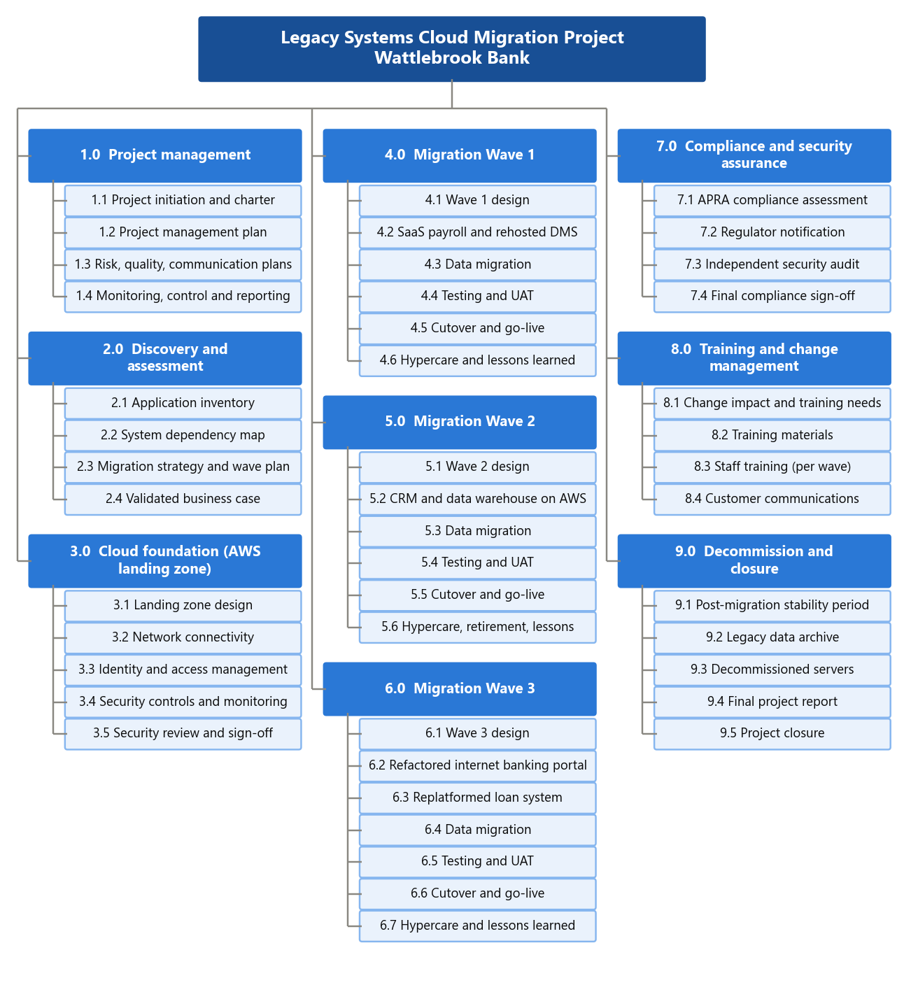
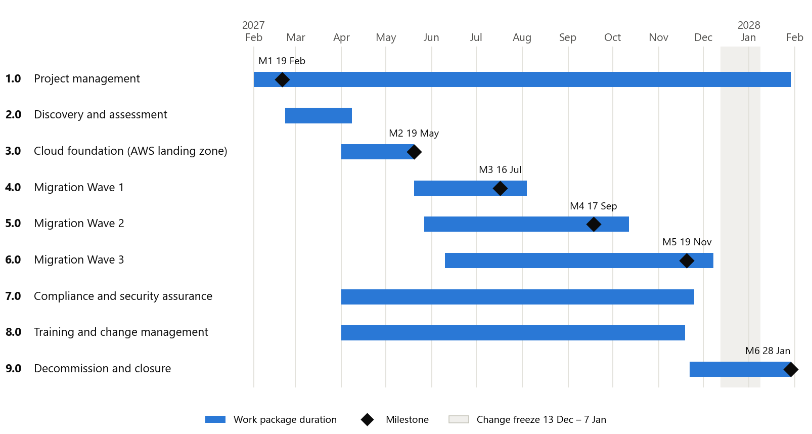
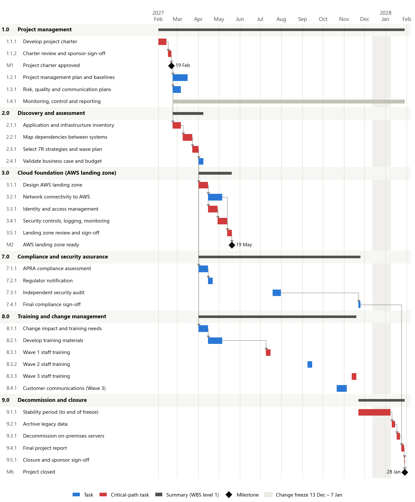
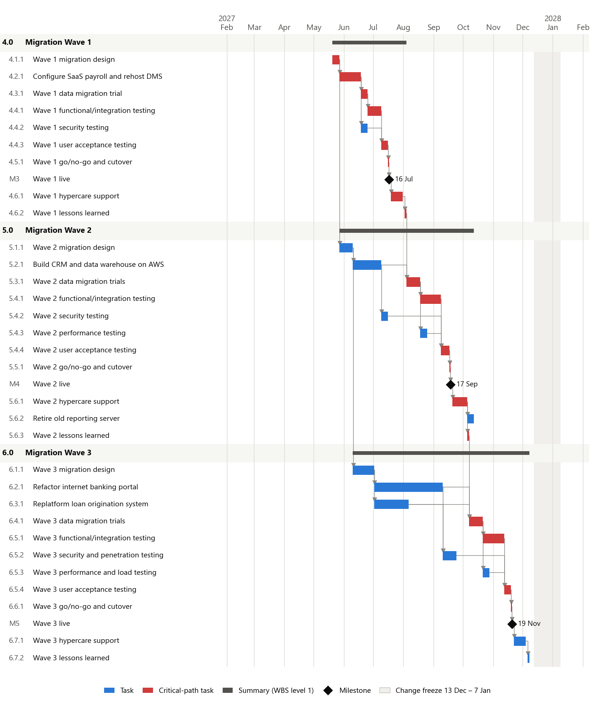

<!-- Owner: Daham Warnakulasuriya -->

# 4 Work Breakdown Structure

The work breakdown structure (WBS) breaks the whole project scope into smaller, manageable pieces of work organised around deliverables [@schwalbe]. It follows the 100% rule: the WBS contains all of the work in the scope statement (Section 3.4) and nothing outside it. Figure 2 shows the first two levels. Level 1 has nine work packages: six management and enabling packages (1.0–3.0 and 7.0–9.0) and the three migration waves (4.0–6.0). Level 3, which forms the schedule, contains 60 activities and 6 milestones and is listed in full in Appendix A.

All three migration waves deliberately use the same structure – design, build, data migration, testing, cutover, then hypercare and lessons learned. This means the team repeats a proven pattern, estimates improve with each wave, and lessons learned can be applied directly to the matching step of the next wave.

Table 11 is the WBS dictionary for level 1. It defines what each work package contains, what it delivers and who owns it.

Table: Table 11. WBS dictionary (level 1)

| WBS | Work package | Description | Main deliverable | Owner |
|-------|----------------|------------------------------------------|----------------------|----------------|
| 1.0 | Project management | Initiation, planning, monitoring and control across the whole project | Charter, project management plan, status reports | Arjun Mehta |
| 2.0 | Discovery and assessment | Inventory of applications and infrastructure, dependency mapping, 7R strategy selection, business case validation | Dependency map and wave plan | Sarah Kim |
| 3.0 | Cloud foundation | Design and build of the AWS landing zone: accounts, network, identity and access, security controls and logging | Signed-off landing zone | Sarah Kim |
| 4.0 | Migration Wave 1 | SaaS payroll and rehosted document management, from design to hypercare | Two systems live on AWS/SaaS | Sarah Kim |
| 5.0 | Migration Wave 2 | CRM and data warehouse replatformed; old reporting server retired | Two systems live; one retired | Sarah Kim |
| 6.0 | Migration Wave 3 | Loan origination replatformed and internet banking portal refactored | Two customer-critical systems live | Sarah Kim |
| 7.0 | Compliance and security assurance | APRA compliance assessment, regulator notification, independent audit and sign-off | Compliance sign-off | Thomas Walker |
| 8.0 | Training and change management | Change impact analysis, training materials, staff training per wave, customer communications | Trained staff; informed customers | Ahmed Hassan |
| 9.0 | Decommission and closure | Stability period, data archiving, server decommissioning, final report | Closed project | Arjun Mehta |

# 5 Project Schedule and Gantt Chart

## 5.1 Scheduling Approach

The schedule was built from the level-3 activities of the WBS using the critical path method (CPM). Each activity has a duration in working days, one or more predecessors, and a responsible person. A forward pass calculates the earliest start and finish of each activity; a backward pass calculates the latest dates; and the difference between them is the total float [@schwalbe]. Activities with zero float form the critical path. Durations were estimated by analogy with the bank's earlier infrastructure projects and from the partner consultancy's estimates, and the riskiest estimate (the internet banking refactor) was checked with a three-point estimate (Section 7.5).

The calendar runs Monday to Friday and excludes Victorian public holidays. All dependencies are finish-to-start. Five scheduling rules shape the plan:

1. **Weekend cutovers.** The go/no-go decision is made on a Friday, the cutover runs from Friday night to Sunday, and the system is live on Monday. Each go/no-go activity can only start on a Friday.
2. **End of financial year.** HR and payroll move only after the 30 June processing is complete, so a year's payroll is never split across two systems.
3. **Lessons learned between waves.** Each wave's lessons-learned review must be finished before the next wave's trial migration starts.
4. **Change freeze.** No changes to live systems from 13 December 2027 to 7 January 2028.
5. **Stability before decommissioning.** Old servers are switched off only after at least 30 days of stable running and after the change freeze ends.

## 5.2 Milestones and Summary Schedule

The project runs for 250 working days, from Monday 1 February 2027 to Friday 28 January 2028. Figure 3 shows the summary schedule with the six milestones from Table 9. The three waves overlap: Wave 2 and Wave 3 design and build start while Wave 1 is still under way, but each wave's data migration, testing and cutover follow the previous wave in sequence.

## 5.3 Detailed Gantt Chart

Figures 4 and 5 show every activity, its timing, its dependencies (grey arrows) and the critical path (red). The management, foundation, compliance, training and closure activity is discussed in Figure 4. Figure 5 covers the three migration waves. Dependencies which span between the two figures, e.g. Wave 1 functional testing (4.4.1) must complete prior to Wave 1 training (8.3.1), are included in the predecessor column of Appendix A, which also provides the exact start and finish dates, responsibility and float for each activity.

The most significant dependencies and their reasons are explained in table 12.

Table: Table 12. Key dependencies

| Predecessor | Successor | Reason |
|------------------------|------------------------|------------------------------------------------|
| 2.3.1 Wave plan | 3.1.1, 7.1.1, 8.1.1 | The landing zone design, compliance assessment and change impact analysis all depend on knowing which systems move, how and when |
| M2 Landing zone ready | 4.1.1 Wave 1 design | No workload moves until the secure foundation is signed off |
| 7.2.1 Regulator notification | 4.5.1 Wave 1 cutover | APRA is notified before the first production workload moves to AWS |
| 4.6.2 Wave 1 lessons learned | 5.3.1 Wave 2 trial migration | Problems found in Wave 1 are fixed before Wave 2 data is moved |
| 5.6.3 Wave 2 lessons learned | 6.4.1 Wave 3 trial migration | The most critical systems benefit from two rounds of lessons |
| 6.2.1 and 6.3.1 Wave 3 builds | 6.4.1 and 6.5.2 | Data cannot be migrated or security-tested until the target systems exist |
| 8.3.1, 8.3.2, 8.3.3 Staff training | Each go/no-go | Staff are trained before they use the new systems |
| 8.4.1 Customer communications | 6.6.1 Wave 3 cutover | Customers receive at least two weeks' notice of the internet banking change |
| M5 Wave 3 live | 9.1.1 Stability period | The 30-day stability period starts only after the last wave is live |
| 7.4.1 Compliance sign-off | 9.4.1 Final report | The project cannot close without compliance sign-off |

## 5.4 Critical Path Analysis

The critical path runs through the whole project: charter (1.1.1–M1) → discovery (2.1.1–2.3.1) → landing zone design, identity and security controls (3.1.1, 3.3.1–3.5.1) → every step of Wave 1 → Wave 2 trial migration, testing and cutover → Wave 3 trial migration, testing and cutover → stability period → archiving, decommissioning and closure (9.2.1–9.5.1). There are 66 lines in the schedule and 40 of these lines are critical.

The wave dependency links the lessons learned deliberately to make the waves linked in series. This means that each wave of testing is impactful on the critical path and every week that Wave 1 testing is delayed results in a delayed go-live date for Wave 3. The project manager then monitors the critical path on a weekly basis. The plan has three types of schedule reserve:

- **Float on non-critical work.** The internet banking refactor (6.2.1) has 18 days of float and the Wave 2 build (5.2.1) also has 18 days, so the two largest build activities can overrun by more than three weeks without moving any milestone. There are 5 days of float for network connectivity (3.2.1).
- **Spare cutover weekends.** Wave 3 will be live on 19 November 2027, but cutovers may be available on 26 November, 3 December and 10 December prior to the change freeze. This leaves three weekends of safety for the most dangerous wave.
- **Time before the hard deadline.** With all three weekends omitted the next cutover window would be 14-16 January 2028 with closure in early March 2028. This is before the end of the hardware support contract on 31 March 2028 (risk R16, Section 7).

## 5.5 Schedule Control

# 6 Resource Allocation and Responsibility Matrix

## 6.1 Resource Plan

## 6.2 Resource Levelling

## 6.3 Responsibility Matrix (RASCI)
