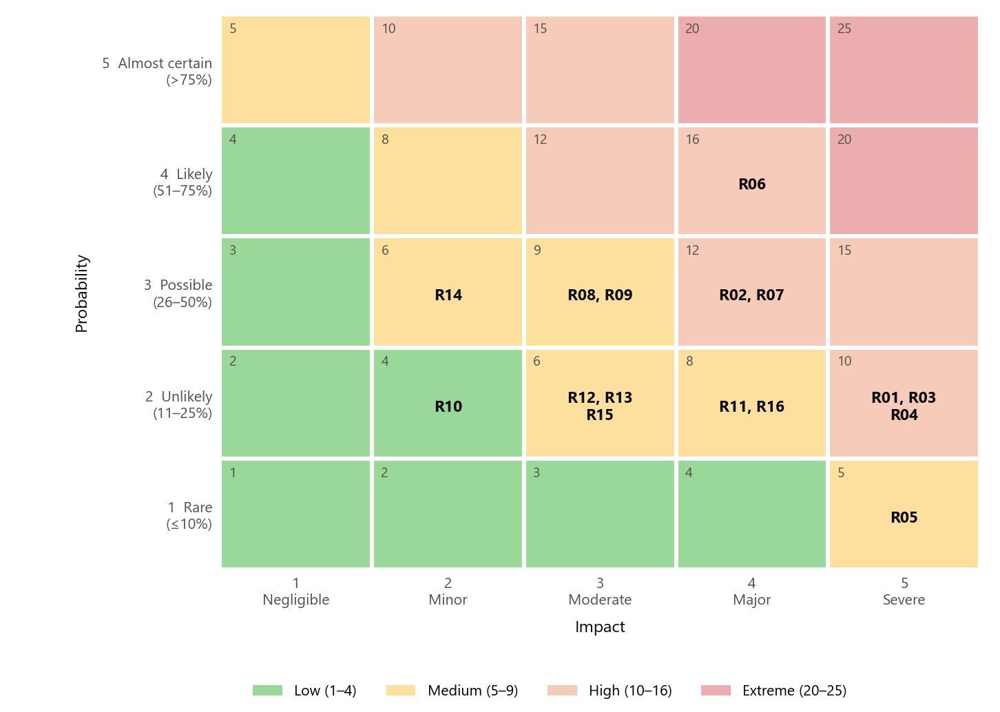

<!-- Owner: Malmika Sandagomi -->

# 7 Risk Management

## 7.1 Approach

Risk management follows the process in ISO 31000:2018 [@iso31000]: establish the context and risk criteria, assess risks (identify, analyse and evaluate them), treat them, and monitor and review them, with communication and recording throughout. Risks were identified through workshops with the project team and business system owners, a review of the assumptions and constraints in the charter, the system dependency analysis, and the risks reported in the cloud migration literature (Section 2), such as vendor lock-in and hidden dependencies between systems [@gholami2016; @oparamartins2016].

Two lessons from the literature shaped the approach. First, IT project overruns are not normally distributed. In a study of 1,471 IT projects the average cost overrun was 27%, but one project in six overran its budget by about 200% on average and its schedule by almost 70% [@flyvbjerg]. The plan therefore does not rely on average outcomes and holds an explicit contingency reserve and schedule reserve. Second, a risk with a low probability but a severe and irreversible impact – a data breach or a regulatory breach, for example – needs strong treatment even when its overall score is only moderate.

## 7.2 Risk Criteria

Probability and impact are each rated on a five-point scale (Table 15). The risk score is probability × impact, giving four rating bands: Low (1–4), Medium (5–9), High (10–16) and Extreme (20–25).

Table: Table 15. Probability and impact scales

| Rating | Probability | Impact (cost / schedule / other) |
|--------|--------------------------|--------------------------------------------------------------|
| 1 | Rare (10% or less) | Negligible: under AUD 20,000; under 1 day |
| 2 | Unlikely (11–25%) | Minor: AUD 20,000–50,000; up to 1 week |
| 3 | Possible (26–50%) | Moderate: AUD 50,000–150,000; 2–4 weeks |
| 4 | Likely (51–75%) | Major: AUD 150,000–400,000; 1–2 months; noticeable customer impact |
| 5 | Almost certain (over 75%) | Severe: over AUD 400,000; data loss; regulatory breach; serious reputational damage |

## 7.3 Risk Register

Table 16 lists the 16 risks identified. Each risk statement is made in cause, event, effect format to be able to address the cause.

Table: Table 16. Risk register

| ID | Risk | Category | P | I | Score | Rating | Owner |
|------|----------------------------------------------|-------------|---|---|--------|----------|--------------|
| R01 | Errors in data mapping or transfer cause data loss or corruption during migration, damaging customer records | Technical | 2 | 5 | 10 | High | Mei Ling Tan |
| R02 | A cutover takes longer than the weekend window, causing a customer-facing outage on Monday | Operational | 3 | 4 | 12 | High | Arjun Mehta |
| R03 | A security misconfiguration in AWS exposes customer data | Security | 2 | 5 | 10 | High | Thomas Walker |
| R04 | The cloud arrangement does not meet APRA CPS 234 or CPS 230 obligations, leading to regulatory action | Regulatory | 2 | 5 | 10 | High | Thomas Walker |
| R05 | Data is stored or processed outside Australia, breaching data residency requirements | Regulatory | 1 | 5 | 5 | Medium | Sarah Kim |
| R06 | Undocumented dependencies between legacy systems are found late, forcing redesign and rework | Technical | 4 | 4 | 16 | High | Sarah Kim |
| R07 | Refactoring the internet banking portal needs more effort than estimated, raising partner costs and squeezing Wave 3 testing | Schedule / cost | 3 | 4 | 12 | High | Sarah Kim |
| R08 | AWS running costs are higher than forecast because resources are oversized or left running | Financial | 3 | 3 | 9 | Medium | Arjun Mehta |
| R09 | IT staff lack AWS skills, slowing the work and weakening support after go-live | Resource | 3 | 3 | 9 | Medium | Ahmed Hassan |
| R10 | Heavy use of provider-specific services increases future switching costs (vendor lock-in) | Strategic | 2 | 2 | 4 | Low | Sarah Kim |
| R11 | A key team member leaves during the project, causing loss of knowledge and delays | Resource | 2 | 4 | 8 | Medium | Arjun Mehta |
| R12 | A legacy application cannot run on the target AWS platform as planned | Technical | 2 | 3 | 6 | Medium | Sarah Kim |
| R13 | System performance is worse after migration, frustrating users | Technical | 2 | 3 | 6 | Medium | Olivia Brown |
| R14 | Staff resist the new systems, reducing adoption and increasing support calls | Organisational | 3 | 2 | 6 | Medium | Ahmed Hassan |
| R15 | The partner consultancy or SaaS vendor misses a delivery date | External | 2 | 3 | 6 | Medium | Arjun Mehta |
| R16 | Wave 3 slips past the last cutover weekend before the change freeze, delaying decommissioning and closure | Schedule | 2 | 4 | 8 | Medium | Arjun Mehta |

## 7.4 Qualitative Analysis

Each risk is depicted on a probability–impact heat map in Figure 6. There are nine "Medium" risk and one "Low" risk, and six "High" risk. The greatest risk is R06, undocumented dependencies (score 16), which is typical when migrating legacy applications: point-to-point interfaces are not often documented over the course of several decades [@gholami2016]. The answer is to invest early in discovery (WBS 2.0), and test all interfaces in the various trial migrations.

The heat map also shows a cluster of risks in the Severe impact column (R01, R03, R04 and R05) with low probabilities. Their scores will not do them justice: if a data breach, data loss or regulatory breach happens to the bank, it's not something that can be undone and it could result in the loss of customers' trust. These risks are therefore treated as priorities equal to the High-rated risks, with avoidance or strong mitigation (Table 18), and are reviewed at every steering committee meeting.

## 7.5 Quantitative Analysis

## 7.6 Risk Responses

## 7.7 Risk Monitoring and Control

# 8 Issue Management

## 8.1 Risks and Issues

## 8.2 Issue Process and Escalation

## 8.3 Issue Log

# 9 Quality Management

## 9.1 Quality Approach

## 9.2 Quality Standards and Metrics

## 9.3 Quality Assurance

## 9.4 Quality Control

## 9.5 Continuous Improvement
