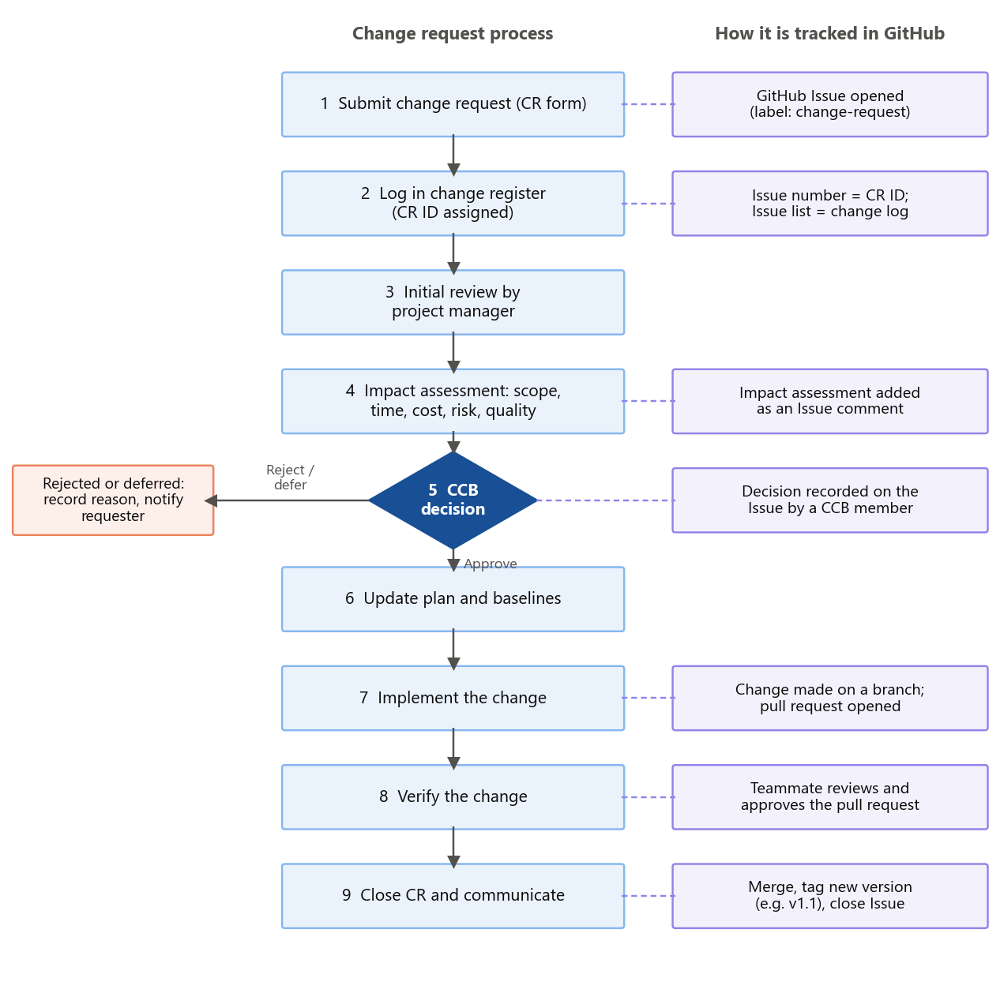

<!-- Owner: Md Sahadat Hossain Shikdar -->

# 10 Change Request Management

## 10.1 Purpose

Once the scope, schedule and cost baselines are approved (task 1.2.1), every change to them must be requested, assessed, approved and recorded before it is made. This integrated change control stops scope creep, makes sure the impact of each change on time, cost, risk and quality is understood before a decision is made, and keeps all project documents consistent with each other [@schwalbe]. Changes that do not affect a baseline, such as correcting a typing error in a runbook, are handled as normal document updates.

## 10.2 Change Request Process

Figure 7 shows the process. The process of making the decision is in the left hand column, and the right hand column displays the steps as captured on GitHub (Section 11).



1. **Submit.** Anyone can raise a change request (CR) using the change request form (Table 23).
2. **Log.** The project manager gives the CR a unique ID and records it in the change register.
3. **Initial review.** The project manager checks that the request is complete and clear, and sends incomplete requests back to the requester.
4. **Impact assessment.** The relevant specialists assess the impact on scope, schedule (including whether the critical path is affected), cost, risk, quality, compliance and resources.
5. **Decision.** The CR is decided at the level set by the approval thresholds (Table 22). The CR may be approved, rejected or deferred and the reason is always documented.
6. **Update baselines.** If the change is approved, the project manager updates the plan, schedule, budget, other documents affected by the change, and establishes a new baseline version.
7. **Implement.** The change is carried out by the assigned owner.
8. **Verify.** A second person checks that the change was made as approved and that nothing else was affected.
9. **Close and communicate.** The CR is closed and the outcome is communicated to the requester and affected stakeholders.

## 10.3 Approval Thresholds

The Change Control Board (CCB) is chaired by the sponsor and includes the project manager, the cloud architect and the security and compliance lead. Including the compliance lead ensures that no change can weaken the bank's regulatory position without being noticed.

Table: Table 22. Change approval thresholds

| Approver | Can approve changes that … |
|-------------------------|-------------------------------------------------------------------|
| Project manager | cost no more than AUD 20,000; stay within an activity's float; do not change a deliverable; and have no compliance impact |
| Change Control Board | cost AUD 20,000–150,000; change a deliverable without moving a milestone; or affect a critical-path activity without moving a milestone |
| Steering committee | cost more than AUD 150,000; move a milestone date; or have a regulatory or customer impact |

## 10.4 Change Request Form

Table: Table 23. Change request form fields

| Field | Content |
|--------------------|--------------------------------------------------------------|
| CR ID and date | Unique number assigned when logged; date raised |
| Requester | Name and business unit |
| Description | What should change |
| Reason and benefit | Why the change is needed and what happens if it is not made |
| Priority | Urgent, high, medium or low |
| Impact assessment | Scope; schedule (days, critical path or float); cost (AUD); risk; quality; compliance; resources |
| Options considered | Alternatives, including doing nothing |
| Decision | Approved, rejected or deferred, with the reason |
| Approver and date | Name, role and date of the decision |
| Implementation | Owner, completion date and verification by a second person |

## 10.5 Change Log

Table 24 shows the change log with illustrative entries. It shows how the thresholds work and why the impact assessment matters.

Table: Table 24. Change log (illustrative entries)

| CR | Change requested | Impact assessment | Decision |
|--------|------------------------------------|---------------------------------------------|------------------|
| CR-01 | Add a mobile banking API to the internet banking refactor (Digital Banking) | +15 days of partner effort on 6.2.1, absorbed by its 18 days of float, so M5 does not move; float falls to 3 days, so the probability of R07 is reassessed; +AUD 60,000, funded by Digital Banking | Approved by the CCB |
| CR-02 | Bring the Wave 2 cutover forward by four weeks (Finance) | Would overlap Wave 1 hypercare, skip the lessons-learned step and cut UAT in half; raises R01, R02 and R06 | Rejected by the CCB: the risk to customer data outweighs the earlier reporting benefit |
| CR-03 | Extend Wave 2 performance testing (5.4.3) by 3 days to include a month-end load test | Within the activity's 10 days of float; AUD 6,000; improves confidence for R13 | Approved by the project manager |
| CR-04 | Migrate the staff intranet as part of Wave 2 (Corporate Services) | +20 days and +AUD 90,000; not in the business case; adds risk to Wave 2 | Deferred to a post-project backlog |

# 11 Configuration Management Using GitHub

## 11.1 Purpose

Configuration management keeps track of the versions of a project's outputs and controls how they change. ISO 10007 describes it as five activities: planning, configuration identification, change control, status accounting and configuration audit [@iso10007]. For this project plan, the configuration items are the plan documents themselves – the charter, the WBS, the schedule, the risk register and the other sections – together with the figures and the schedule (Gantt chart) workbook. The team chose GitHub because it records every change, who made it and when; supports review before a change is accepted; and is widely used in industry.

## 11.2 Configuration Identification

Each report section is a separate Markdown file in the repository, and each file has one owner. The repository is organised as follows:

```
wattlebrook-cloud-migration-plan/
├── sections/                   project brief and report sections, one file each
├── references/                 reference list and IEEE citation style
├── figures/                    charts and diagrams used in the report
├── gantt/                      schedule (Gantt chart) workbook
├── screenshots/                Jira and GitHub evidence
├── .github/                    change request and pull request templates
├── CHANGELOG.md                summary of each version
└── README.md                   who owns what and how to work
```

Versions are identified with tags: v0.1 for the agreed outline, v0.5 for the first full draft, v0.9 for the reviewed draft and v1.0 for the submitted report.

## 11.3 Change Control in GitHub

The main branch holds the approved version of the plan. Changes are made on a separate branch, for example `section/risk-register`, and are merged into the main branch only through a pull request that another team member has reviewed and approved [@githubpr]. Commit messages state the section and the change, for example "Section 7: add EMV analysis for top five risks". Baseline changes follow the process in Section 10:

1. **Raise.** The change request is raised as a GitHub Issue using the repository's change request template, which contains the fields in Table 23, and is labelled `change-request`.
2. **Assess and decide.** The impact assessment and the decision are recorded as comments on the Issue, and the Issue is labelled `approved`, `rejected` or `deferred`.
3. **Implement and review.** An approved change is made on a branch and submitted as a pull request that links to the Issue. A teammate reviews and approves it.
4. **Record.** The change is merged, a new version is tagged, and the Issue is closed. The Issue list therefore works as the change log.

## 11.4 Status Accounting and Audit

The commit history, closed Issues, pull requests and tagged versions give a complete record of how the plan developed and who contributed what. CHANGELOG.md summarises each version in plain language. Before submission, the team runs a configuration audit to confirm that:

- every section has been merged through a reviewed pull request;
- every figure matches the final schedule;
- every citation matches the reference list; and
- the final document is complete and correctly formatted.

## 11.5 Evidence

The repository is available at **[add GitHub repository link]**. Screenshots of the commit history, contributors, a reviewed pull request, the change request Issues and the tagged versions are included in Appendix B.

# 12 Communication Management Plan

## 12.1 Objectives

## 12.2 Communication Matrix

## 12.3 Reporting

## 12.4 Escalation

# 13 Team Collaboration Using Jira
