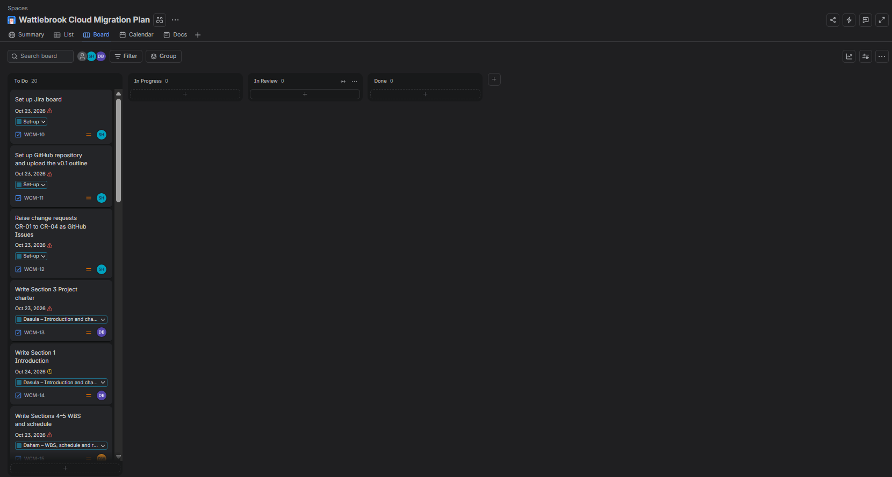
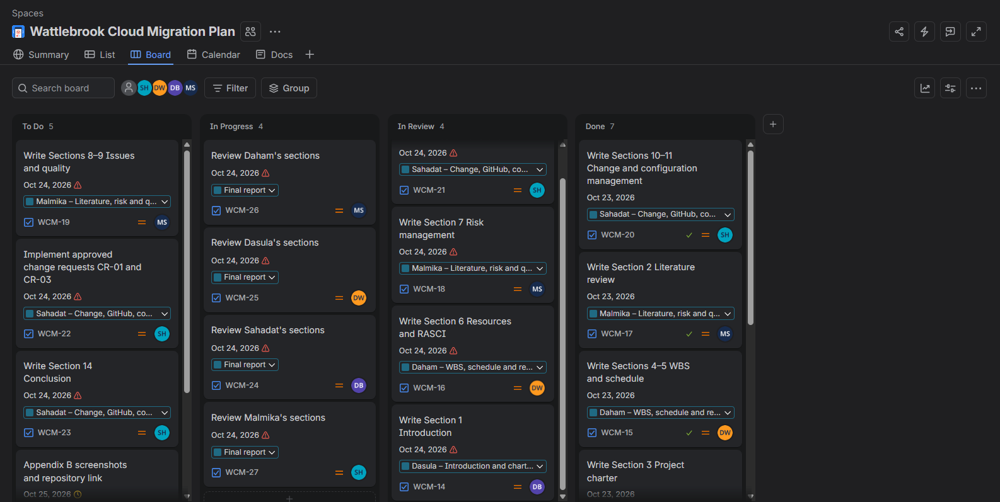
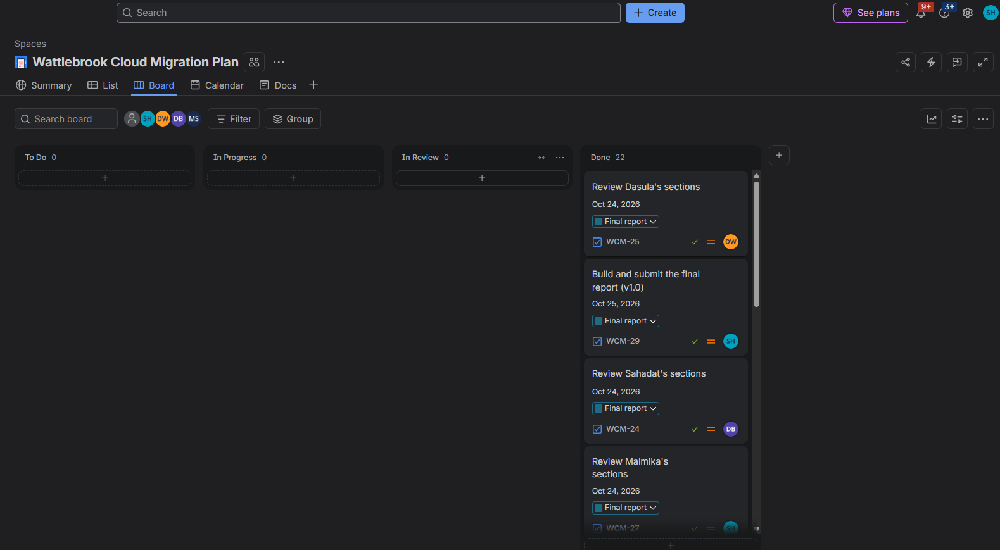
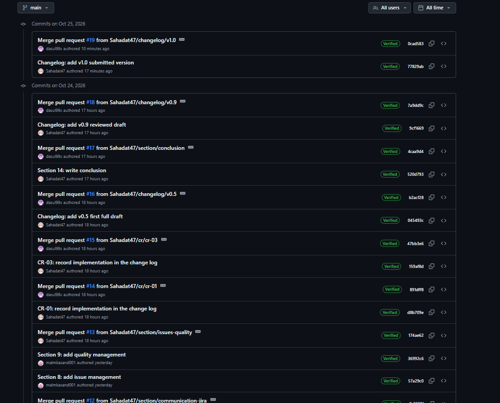
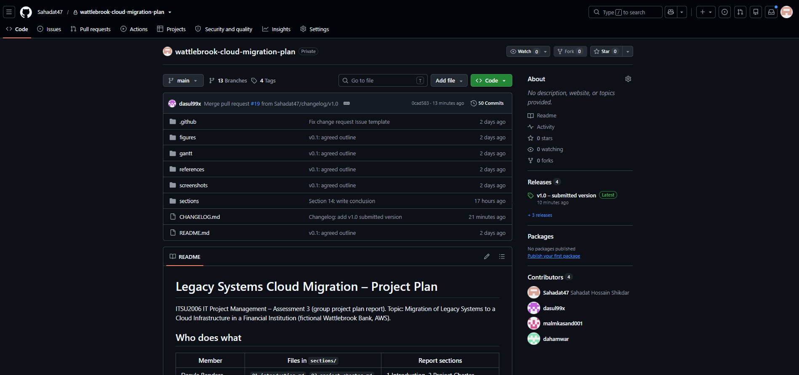
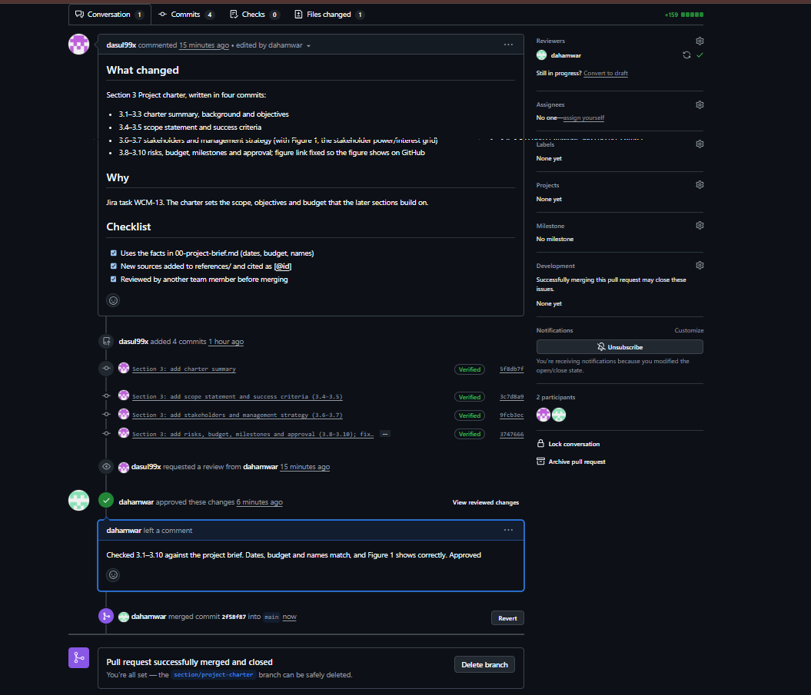
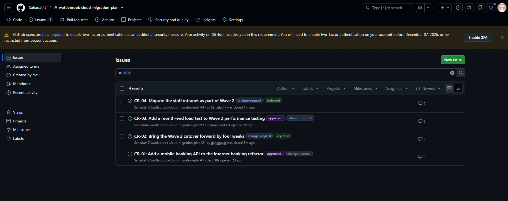
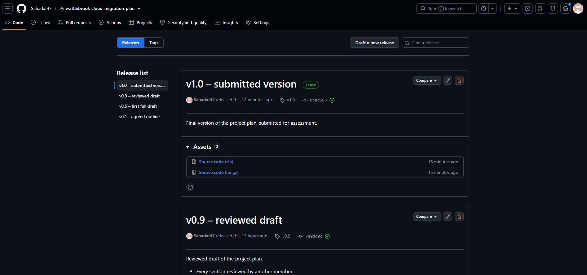

<!-- Owner: Md Sahadat Hossain Shikdar. Save each screenshot in screenshots/ with the file name used below. -->

# Appendix B: Collaboration and Configuration Management Evidence

## B.1 Jira Board

## B.2 GitHub Repository

Repository: https://github.com/Sahadat47/wattlebrook-cloud-migration-plan

